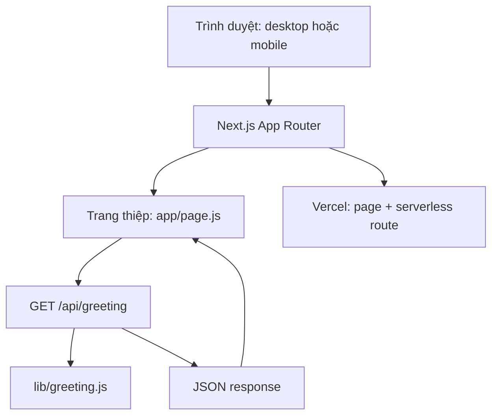

# Báo cáo dự án: Lá thư 20·10

**Phiên bản:** Mẫu ban đầu
**Nền tảng:** Next.js 16.4.2, React 19.3.1, Vercel
**Lưu trữ dữ liệu:** Không dùng database

## 1. Mục tiêu

Tạo một trang thiệp chúc mừng 20/10 có thể dùng trên điện thoại và desktop. Người xem mở phong bì, nhận lời chúc nổi bật, rồi lật sang mặt thiệp có nội dung chi tiết. Tông màu chính là hồng và trắng; hoa và trái tim rơi sau khi mở thư.

## 2. Phạm vi mẫu

- Trang đơn tiếng Việt, co giãn theo màn hình.
- Phong bì CSS có thể mở bằng nút hoặc thao tác kéo xuống.
- Sau khi mở, màn hình chuyển vào phong bì rồi phát toàn bộ video hoa ở tốc độ gốc; thiệp xuất hiện khi video kết thúc.
- Hai mặt thiệp: lời chúc lớn ở mặt trước và lời chúc chi tiết ở mặt sau.
- Có thể lật bằng nút hoặc vuốt ngang; có hướng dẫn thao tác.
- Hoa và trái tim rơi liên tục sau khi mở thư; tắt chuyển động trang trí khi hệ điều hành bật `prefers-reduced-motion`.
- API đọc lời chúc; nội dung mẫu nằm trong mã nguồn.
- Có hướng dẫn chạy, test, build và đưa dự án lên Vercel.

## 3. Thiết kế kỹ thuật



| Thành phần | Vai trò |
|---|---|
| `app/page.js` | Mở phong bì, điều phối thời điểm phát video, lật bằng vuốt hoặc nút, hiển thị hiệu ứng. |
| `components/FlowerVideoTransition.js` | Phát video hoa muted/inline; hiện thiệp sau sự kiện `ended`, chuyển thẳng tới thiệp nếu media lỗi. |
| `public/videos/flower-transition.mp4` | Video chuyển cảnh hoa, 1080×1080, thời lượng 9,533 giây. |
| `app/globals.css` | Bố cục responsive, phong bì/thiệp CSS, màu sắc, animation và giảm chuyển động. |
| `app/api/greeting/route.js` | Route `GET` trả nội dung JSON; không ghi dữ liệu. |
| `lib/greeting.js` | Nguồn nội dung hai mặt thiệp, dễ sửa lời chúc. |
| `tests/greeting.test.mjs` | Kiểm tra API trả đúng dịp lễ và đủ hai mặt thiệp. |

Next.js Route Handler được đặt trong `app/api/.../route.js`; Vercel hỗ trợ triển khai ứng dụng Next.js theo cấu hình mặc định. Mẫu không cần `vercel.json` hay database ([Route Handlers](https://nextjs.org/docs/app/getting-started/route-handlers), [Next.js trên Vercel](https://vercel.com/docs/frameworks/full-stack/nextjs)).

## 4. Luồng người xem

1. Mở trang sẽ thấy phong bì và nút **Mở thiệp**.
2. Chạm nút hoặc kéo phong bì xuống. Nắp phong bì mở, trang cuộn đến thiệp.
3. Sau giai đoạn tiến vào phong bì, video hoa chạy trọn 9,533 giây; khi clip kết thúc, lời chúc 20/10 cỡ lớn hiện ra.
4. Vuốt sang trái hoặc bấm **Lật thiệp** để xem lời chúc chi tiết; vuốt phải để trở lại.
5. Hoa và trái tim tiếp tục rơi trên thiệp; khi bật `prefers-reduced-motion`, video được bỏ qua và thiệp mở ngay.

## 5. Chạy và triển khai

### Chạy local

```bash
npm install
npm run dev
```

Mở `http://localhost:3000`. Endpoint mẫu: `http://localhost:3000/api/greeting`.

### Kiểm tra và build

```bash
npm test
npm run build
npm start
```

### Đưa lên Vercel

Đẩy mã nguồn lên Git provider, import repository trong Vercel và triển khai với preset Next.js. Build command là `npm run build`; không cần cấu hình database hoặc environment variable. Việc deploy công khai chưa được thực hiện trong phạm vi mẫu này.

## 6. Bảo mật và giới hạn

- API là endpoint công khai, chỉ đọc một object lời chúc, không nhận input và không ghi dữ liệu; response có cache header để giảm request lặp. Không có thao tác tạo dữ liệu để spam/brute-force. Nếu thêm `POST`, tạo nội dung hoặc gửi form, cần giới hạn tốc độ theo IP/session và kiểm tra input; có thể bổ sung edge rate limiting nếu lưu lượng GET bị lạm dụng.
- Không có truy vấn SQL, tài khoản, phiên đăng nhập hoặc dữ liệu theo người dùng; SQL injection và IDOR không áp dụng với luồng hiện tại.
- Nội dung API được React render dưới dạng text nên được escape mặc định; không dùng `dangerouslySetInnerHTML`.
- Route chỉ có `GET` và không có thao tác thay đổi dữ liệu, nên CSRF không áp dụng.
- Nếu thay nội dung mẫu bằng dữ liệu cá nhân hoặc nội dung do khách gửi, cần thiết kế quyền truy cập và kiểm tra đầu vào trước khi lưu/hiển thị.
- Hiệu ứng giảm theo `prefers-reduced-motion`; phiên bản mẫu không phụ thuộc ảnh bên ngoài hoặc dịch vụ lưu trữ.

## 7. Kết quả xác minh

- `npm test`: đạt, 1 kiểm tra API.
- `npm run build`: đạt với Next.js 16.4.2.
- HTTP smoke: `GET /api/greeting` trả `200` cùng cache headers; `POST` trả `405`.
- Video local tải đúng metadata 1080×1080, dài 9,533 giây; byte-range trả `206 video/mp4`.
- Trình duyệt desktop và mobile 390×844 phát video đến `ended` rồi mới hiện thiệp; mobile không tràn ngang.
- Với `prefers-reduced-motion`, video được bỏ qua, thiệp mở ngay và lớp phủ video được ẩn.
- Chưa deploy công khai lên Vercel.

## 8. Mở rộng sau này

Sửa câu chữ và phong cách trong `lib/greeting.js` và `app/globals.css`. Nếu cần cá nhân hoá theo người nhận, có thể nhận tên qua query parameter, giới hạn độ dài và hiển thị như text; chưa cần database cho nhu cầu đó.
